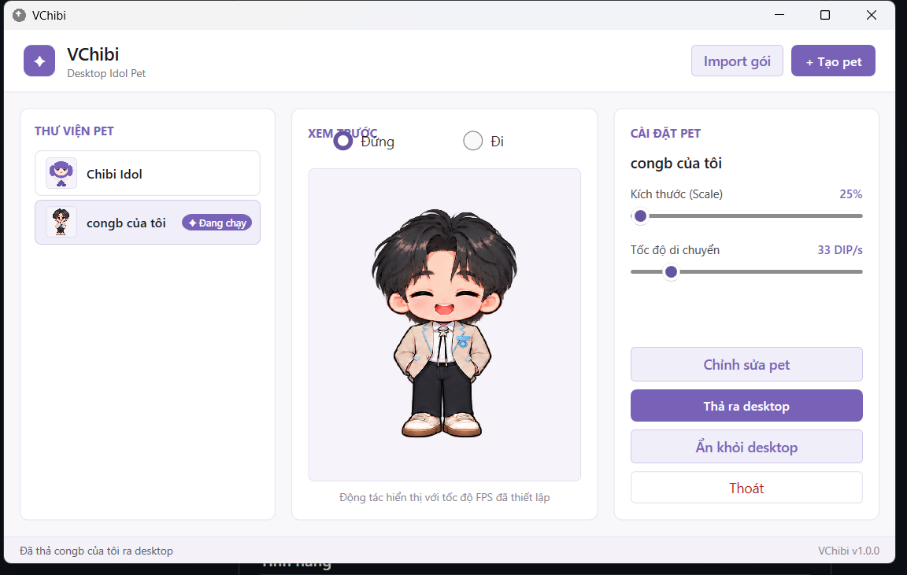
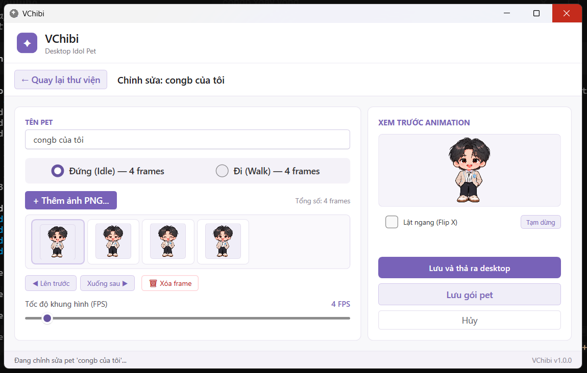
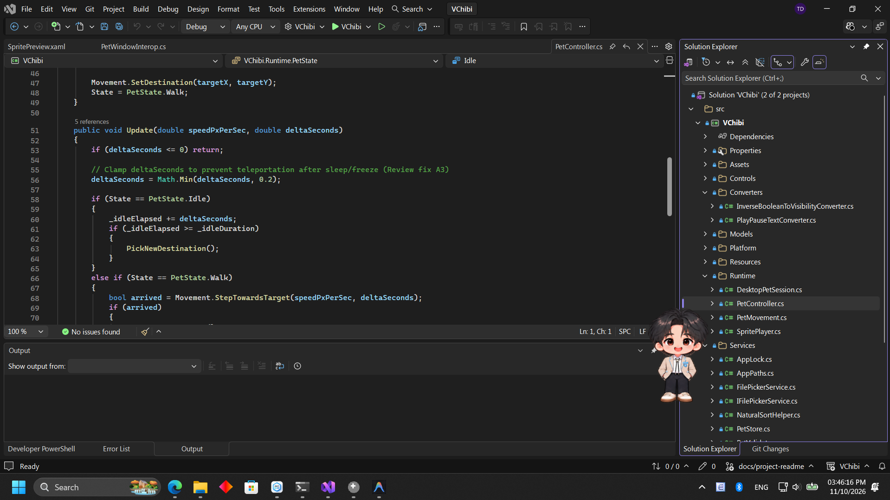
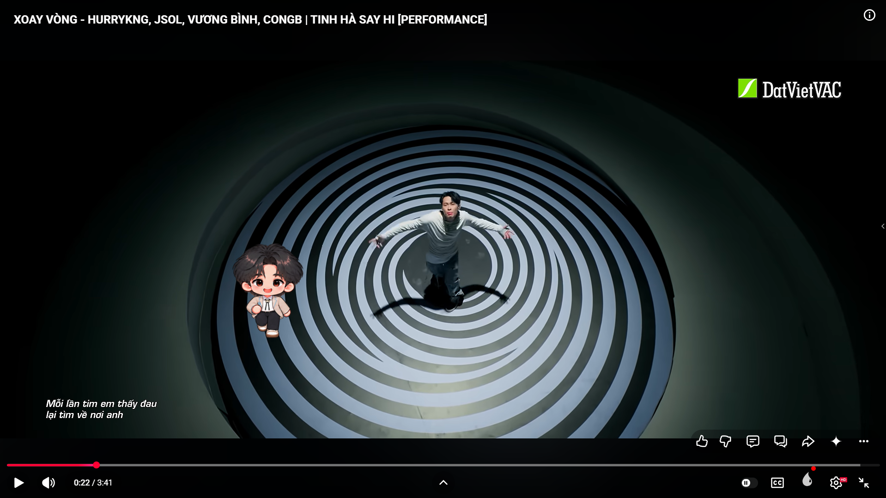

# VChibi — Desktop Idol Pet

[](https://github.com/UGing265/VChibi/actions/workflows/release.yml)
[](NOTICES.md)

**Mang một nhân vật chibi lên desktop Windows — đi dạo, đứng nghỉ và đồng hành cùng bạn khi làm việc.**

VChibi là ứng dụng desktop pet 2D dùng animation PNG, xây dựng bằng **C# / .NET 10 / WPF**. Bạn quản lý thư viện nhân vật, tạo pet từ ảnh và thả nhân vật trực tiếp lên màn hình, không chỉ xem animation trong cửa sổ ứng dụng.

[Tải bản phát hành](https://github.com/UGing265/VChibi/releases) · [Hướng dẫn chi tiết](docs/user-guide.md) · [Báo lỗi / góp ý](https://github.com/UGing265/VChibi/issues) · [Changelog](docs/changelog.md)

## Nội dung

- [Ảnh minh họa](#ảnh-minh-họa)
- [Tính năng](#tính-năng)
- [Cài đặt](#cài-đặt)
- [Hướng dẫn sử dụng](#hướng-dẫn-sử-dụng)
- [Kiến trúc](#kiến-trúc)
- [Folder structure](#folder-structure)
- [Phát triển và phát hành](#phát-triển-và-phát-hành)
- [Thành viên](#thành-viên)
- [Bản quyền](#bản-quyền)

## Ảnh minh họa

### Thư viện nhân vật



### Trình chỉnh sửa pet



### Đồng hành khi làm việc



### Đồng hành khi xem video



## Tính năng

- **Desktop pet:** nhân vật di chuyển ngẫu nhiên và luân phiên animation Đứng (`idle`) / Đi (`walk`).
- **Click-through:** cửa sổ pet được cấu hình cho thao tác chuột xuyên xuống ứng dụng bên dưới, không giành focus.
- **Thư viện pet:** chọn xem trước, thả, ẩn và thay nhân vật đang hoạt động.
- **Pet Editor:** tạo/sửa pet từ PNG, sắp xếp frame và chỉnh FPS riêng cho từng động tác.
- **Import:** nhập gói pet từ thư mục chứa `pet.json` và ảnh PNG.
- **Cài đặt riêng từng pet:** kích thước 25%–400%, tốc độ 5–200 DIP/s.
- **Khay hệ thống:** đóng cửa sổ quản lý để ẩn về tray; pet vẫn có thể tiếp tục hoạt động.
- **Giao diện:** nền sáng, điểm nhấn Lavender `#7862B8`, không thay đổi theme Windows.

Hiện tại tập trung vào sprite 2D và hai động tác Đứng/Đi; không mô tả hát, giọng nói hay AI hội thoại là tính năng đã có.

## Cài đặt

**Nền tảng:** Windows 10/11 x64.

1. Mở [GitHub Releases](https://github.com/UGing265/VChibi/releases).
2. Tải ZIP `VChibi-v0.1.<số>-win-x64.zip` của bản muốn dùng.
3. Giải nén **toàn bộ ZIP** vào một thư mục.
4. Chạy `VChibi.exe`.

Bản phát hành self-contained kèm runtime .NET. Không cần cài SDK để dùng ứng dụng; không tách riêng EXE khỏi assets và các file runtime.

Nếu chưa có Release, xem mục [chạy từ mã nguồn](#chạy-từ-mã-nguồn).

## Hướng dẫn sử dụng

### Chọn và thả pet

1. Chọn nhân vật trong danh sách thư viện để xem trước.
2. Điều chỉnh kích thước và tốc độ nếu cần.
3. Bấm **Thả ra desktop** để kích hoạt nhân vật đó.
4. Bấm **Ẩn khỏi desktop** khi muốn tạm ẩn.

**Chọn pet trong thư viện không tự thay pet trên desktop.** Chỉ thao tác thả mới đổi nhân vật đang hoạt động.

### Tạo hoặc sửa pet

1. Bấm **Tạo pet mới**, hoặc chọn pet rồi bấm **Chỉnh sửa**.
2. Đặt tên nhân vật.
3. Thêm PNG cho động tác **Đứng (Idle)** và **Đi (Walk)**.
4. Sắp xếp thứ tự frame, đặt FPS từ 1 đến 60 và xem preview.
5. Bấm **Lưu thay đổi** hoặc **Lưu và thả ra desktop**.

**Chuẩn bị ảnh:** dùng nền trong suốt, cùng kích thước canvas, cùng tỉ lệ nhân vật và cùng đường gót chân cho cả Idle/Walk. Chỉ làm canvas bằng nhau chưa đủ nếu nhân vật trong ảnh vẫn khác chiều cao. Thanh Scale phóng to/thu nhỏ cả pet, không sửa riêng độ lệch giữa hai động tác.

### Nhập gói có sẵn

Bấm **Nhập gói pet**, chọn thư mục chứa `pet.json`. Một gói thường có cấu trúc:

```text
my-pet/
├── pet.json
├── idle/
│   ├── 001.png
│   └── 002.png
└── walk/
    ├── 001.png
    └── 002.png
```

App kiểm tra gói và sao chép dữ liệu vào kho nội bộ. Dùng thư mục gói, không chọn trực tiếp sprite sheet hoặc file ZIP.

### Tray và dữ liệu

- Đóng cửa sổ quản lý bằng `X`: ẩn về khay hệ thống.
- Nhấp đúp icon tray: mở lại cửa sổ quản lý.
- Bấm **Thoát ứng dụng**: đóng hoàn toàn ứng dụng.
- Dữ liệu nằm trong `%LOCALAPPDATA%\VChibi\`: `settings.json` và `Pets/<id>/`.
- App lưu bản sao ảnh đã import; chỉnh ảnh nguồn bên ngoài không tự cập nhật pet đang lưu.

Xem thêm [hướng dẫn sử dụng](docs/user-guide.md).

## Kiến trúc

Một project WPF, tổ chức **MVVM**, chia folder theo trách nhiệm:

| Thành phần | Trách nhiệm |
|---|---|
| `App.xaml.cs` | Khởi tạo và nối các thành phần; quản lý vòng đời ứng dụng |
| `Views` | XAML, giao diện thư viện/editor và cửa sổ pet |
| `ViewModels` | Trạng thái UI, binding và commands |
| `Models` | Định nghĩa pet, animation và cài đặt |
| `Services` | Đọc/lưu pet, kiểm tra gói, settings, file picker và khóa đơn phiên |
| `Runtime` | Nạp/phát frame, chuyển trạng thái Đứng/Đi, di chuyển và desktop session |
| `Platform/Windows` | Win32 HWND, click-through, vùng làm việc/DPI và tray |
| `Controls`, `Converters`, `Resources` | Preview dùng lại, binding converters và theme/styles |

`LibraryViewModel` quản lý thư viện và pet được chọn; `PetEditorViewModel` quản lý bản chỉnh sửa. `DesktopPetSession` phối hợp `SpritePlayer`, `PetController`, `PetMovement` và `PetWindow` để hiển thị pet trên desktop. Logic HWND/DPI/tray nằm ở lớp Windows, không đưa vào model dữ liệu.

Pet đã lưu và cài đặt nằm ngoài thư mục cài app. Khóa `.instance.lock` hạn chế mở nhiều phiên cùng data root; thao tác ghi dữ liệu có staging/khôi phục để giảm rủi ro hỏng gói.

## Folder structure

```text
VChibi/
├── VChibi.sln
├── NOTICES.md
├── README.md                      # Giới thiệu dự án
├── .github/
│   └── workflows/
│       └── release.yml
├── src/
│   └── VChibi/
│       ├── VChibi.csproj
│       ├── App.xaml
│       ├── App.xaml.cs
│       ├── app.manifest
│       ├── Views/
│       ├── ViewModels/
│       ├── Models/
│       ├── Services/
│       ├── Runtime/
│       ├── Platform/Windows/
│       ├── Controls/
│       ├── Converters/
│       ├── Resources/
│       ├── Assets/
│       │   ├── app.ico
│       │   └── DefaultPet/
│       └── Properties/PublishProfiles/
│           └── Windows.pubxml
├── tests/
│   └── VChibi.Tests/
│       ├── Runtime/
│       ├── Storage/
│       └── ViewModels/
├── scripts/                       # Smoke scripts PowerShell
└── docs/
    ├── images/                    # Ảnh minh họa README
    ├── user-guide.md
    ├── release.md
    ├── changelog.md
    ├── evidence/                  # Bằng chứng kiểm thử đã lưu
    ├── plans/
    └── journals/
```

`bin/`, `obj/`, `artifacts/` là đầu ra build, không phải source. Ảnh nguồn cá nhân trong `assets/congb/` được loại khỏi Git và gói phát hành.

## Phát triển và phát hành

### Chạy từ mã nguồn

Cần Windows x64, Git và **.NET 10 SDK** có khả năng build WPF.

```powershell
git clone https://github.com/UGing265/VChibi.git
Set-Location VChibi
dotnet run --project src/VChibi/VChibi.csproj
```

Chạy với dữ liệu tạm riêng khi thử nghiệm, không sửa thư viện pet đang dùng:

```powershell
dotnet run --project src/VChibi/VChibi.csproj -- --data-dir "$env:TEMP\VChibi-dev"
```

### Kiểm tra và đóng gói

```powershell
dotnet test VChibi.sln -c Release
dotnet publish src/VChibi/VChibi.csproj -c Release -p:PublishProfile=Windows -p:PublishDir="$PWD/artifacts/publish/win-x64/"
```

Đóng gói toàn bộ thư mục publish, không chỉ `VChibi.exe`.

### CI/CD

- **PR vào `main`:** build/test, publish và lưu artifact ZIP để kiểm tra.
- **Push/merge vào `main`:** sau khi kiểm tra và đóng gói đạt, tạo tag `v0.1.<github.run_number>` rồi công khai GitHub Release kèm ZIP.
- **Rerun:** dùng lại tag của cùng workflow run.
- Số phiên bản có thể nhảy vì PR/lần chạy lỗi cũng tiêu thụ số run.

Xem [quy trình phát hành](docs/release.md). CI xanh không thay thế kiểm thử thực tế click-through, DPI, tray, Sleep hoặc môi trường Windows sạch; các giới hạn kiểm thử được ghi trong [verification](docs/plans/261011-vchibi-desktop-pet/verification.md).

### Đóng góp

Mở issue để báo lỗi hoặc đề xuất tính năng; gửi thay đổi qua PR. Với lỗi giao diện, kèm ảnh, phiên bản ứng dụng, Windows/DPI và bước tái hiện; tránh gửi dữ liệu cá nhân hoặc artwork không có quyền phân phối.

## Thành viên

| Thành viên | Thông tin |
|---|---|
| [UGing265](https://github.com/UGing265) | Chủ repository và contributor được ghi nhận trên GitHub |

[Danh sách contributors trên GitHub](https://github.com/UGing265/VChibi/graphs/contributors) cập nhật theo đóng góp thực tế.

## Bản quyền

**Copyright (c) 2026 VChibi Authors.**

- **Mã nguồn VChibi:** MIT License theo [NOTICES.md](NOTICES.md). Cho phép sử dụng, sửa đổi và phân phối, kể cả thương mại, với điều kiện giữ thông báo bản quyền và giấy phép.
- **Pet mẫu `src/VChibi/Assets/DefaultPet/`:** CC0 1.0 theo thông báo hiện có trong `NOTICES.md`.
- **Thư viện bên thứ ba:** WPF-UI, CommunityToolkit.Mvvm và .NET/WPF giữ giấy phép/thông báo riêng, được liệt kê trong `NOTICES.md`.
- **Pet/artwork người dùng import:** không mặc nhiên thuộc giấy phép MIT hoặc CC0 của dự án. Quyền sử dụng và phân phối phụ thuộc tác giả/chủ sở hữu từng bộ ảnh.

Phần mềm cung cấp “AS IS”, không kèm bảo đảm, theo điều khoản MIT đầy đủ trong [NOTICES.md](NOTICES.md).
